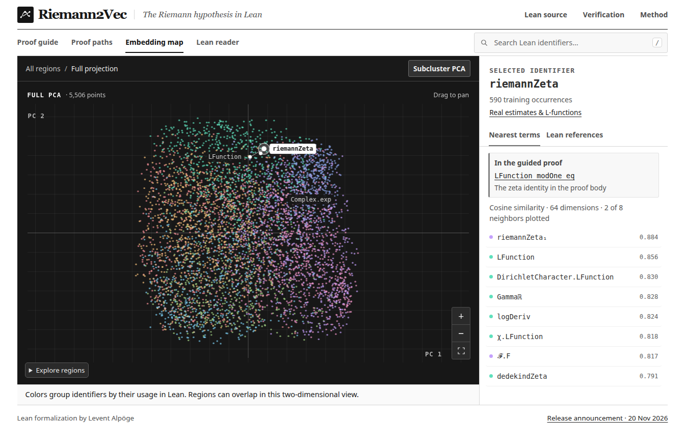
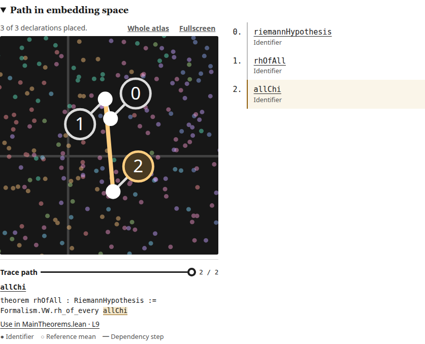
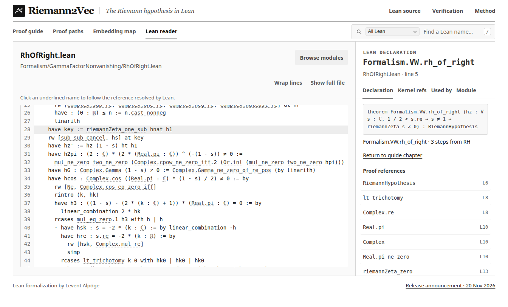

# Riemann2Vec

Where does the proof that every nontrivial zeta zero lies on the critical line actually use nonvanishing? Riemann2Vec lets you follow that question from the exported Lean theorem to the line that invokes the relevant lemma. It also maps 69,737 identifiers by how they are used across Levent Alpöge’s original Lean release.



## Try it locally

From the repository root, run the static site with Python 3.

```sh
python3 -m http.server 8000 --bind 127.0.0.1 --directory docs
```

Open the [proof guide](http://127.0.0.1:8000/). The site includes the trained atlas and the indexed proof snapshot. Opening a guide chapter, following a proof path, or inspecting a bundled declaration works without installing Lean or training a model.

## Follow a proof path

Open the two-step path `riemannHypothesis → rhOfAll → allChi`. Move **Trace path** to step 2. The highlighted line in `MainTheorems.lean` shows exactly where `rhOfAll` passes `allChi` to `Formalism.VW.rh_of_every`. Select the line to open the reader. The URL preserves the selected step. [Open this path locally](http://127.0.0.1:8000/#proof=riemannHypothesis&target=allChi&space=1&step=2)



The path graph contains 993 declarations from 63 indexed modules. Each directed edge records a reference in the caller’s compiled body. Distance counts edges along a shortest path within this snapshot. Each plotted position comes from an identifier’s own vector or, for a ring marker, an average of embedded references in the declaration.

## Read the argument in Lean

In **Reflect a zeta zero**, jump to `riemannZeta_one_sub` at line 28. The reader opens the functional-equation call inside `Formalism.VW.rh_of_right`. Follow an underlined constant to inspect its declaration, or open **Kernel refs** to see what the compiler recorded in the type and the proof body. [Open the reflection chapter locally](http://127.0.0.1:8000/#guide=zeta-reflection)



## Explore related identifiers

Search for `riemannZeta` in the embedding map to see names used in similar Lean contexts. Its eight nearest neighbors are ranked by cosine similarity in 64 dimensions. Color groups the vocabulary into eight regions and 24 subclusters. The global map projects a sample into two dimensions. Opening a subcluster gives that group its own projection. [Open the zeta neighborhood locally](http://127.0.0.1:8000/#term=riemannZeta&projection=full)

## Source and attribution

Levent Alpöge released the formalization on **20 November 2026**. His four-page announcement describes the work with Claude and links the original Lean archive. The atlas was trained on the published Lean files preserved at commit `40e56bab026552e089d7afcfeff08d2defb9c005` in the Lean community mirror. [Alpöge’s original announcement (PDF)](https://alpo.ge/remark.pdf) · [Pinned Lean source](https://github.com/leanprover-community/riemann-hypothesis/tree/40e56bab026552e089d7afcfeff08d2defb9c005) · [Independent verification by the Lean FRO and Mathlib Initiative](https://leanprover-community.github.io/blog/posts/riemann-hypothesis/)

## Rebuild or host

The browser app and its assets live in [docs/](docs/). For branch-based GitHub Pages hosting, use `main` and the `/docs` folder after merging. The optional Python reader can resolve declarations beyond the bundled snapshot using the pinned source and the community build cache. [Development and data rebuild instructions](DEVELOPMENT.md)
